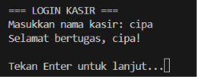
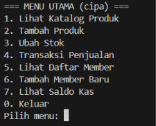
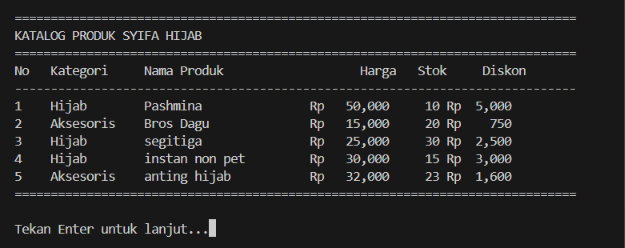
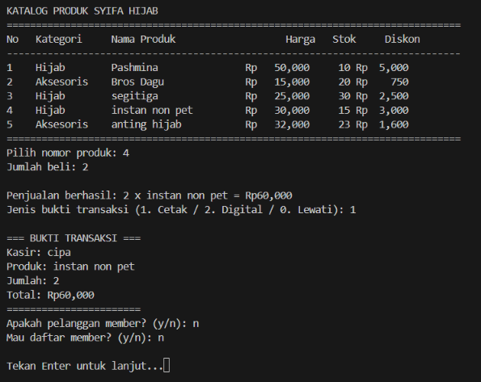
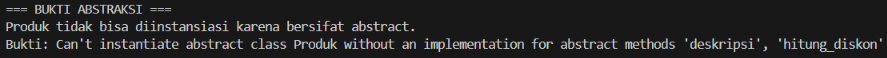
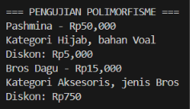
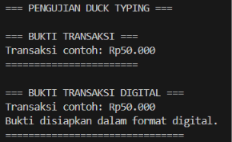

# Toko Syifa Hijab
Toko Syifa Hijab adalah program kasir sederhana menggunakan Python untuk mengelola produk hijab dan aksesoris. Program ini memiliki fitur melihat katalog, menambah produk, mengubah stok, melakukan transaksi penjualan, mengelola data member, menambahkan poin pelanggan, dan melihat saldo kas.

# Cara Menjalankan Program
Buka terminal dan jalankan perintah berikut:
python syifa_hijab.py
Masukkan nama kasir untuk masuk ke menu utama.

# Hubungan Antarclass
-Inheritance
Class `Hijab` dan `Aksesoris` mewarisi class `Produk`. Keduanya menggunakan atribut dan metode umum dari `Produk`, tetapi memiliki atribut khusus masing-masing, yaitu `bahan` pada `Hijab` dan `jenis` pada `Aksesoris`.
-Association (Asosiasi)
Class `Kasir` berhubungan dengan class `Produk` saat transaksi penjualan berlangsung. Kasir menggunakan data produk untuk menghitung total pembayaran dan mengurangi stok produk yang dibeli.
-Aggregation
Class `Toko` menyimpan kumpulan objek `Produk` di dalam atribut `katalog_produk`. Hubungan ini termasuk agregasi karena produk dapat dibuat secara terpisah dan tidak harus dibuat langsung oleh class `Toko`.
-Composition
Class `Pelanggan` memiliki objek `AkunPoint` yang dibuat langsung saat objek pelanggan dibuat. Akun poin menjadi bagian dari data pelanggan dan dibuat melalui constructor `Pelanggan`.

# Penerapan Abstraction
Abstraction diterapkan pada class `Produk` yang mewarisi `ABC` dari modul `abc`. Class `Produk` memiliki dua abstract method, yaitu `hitung_diskon()` dan `deskripsi()`.
Class `Hijab` dan `Aksesoris` mengimplementasikan kedua metode tersebut dengan cara yang berbeda. Class `Produk` juga memiliki metode konkret seperti `get_stok()`, `set_stok()`, dan `kurangi_stok()` yang dapat digunakan oleh subclass.
Karena `Produk` merupakan class abstrak, objeknya tidak dapat dibuat secara langsung. Jika dicoba, Python akan menghasilkan `TypeError` karena abstract method belum diimplementasikan.

# Penerapan Inheritance
Inheritance diterapkan melalui class `Hijab` dan `Aksesoris` yang mewarisi class `Produk`. Keduanya menggunakan `super().__init__()` untuk memanggil constructor dari class induk.
Selain atribut umum dari `Produk`, masing-masing subclass memiliki atribut khusus. Class `Hijab` memiliki atribut `bahan`, sedangkan class `Aksesoris` memiliki atribut `jenis`.
Class `Produk` juga menerapkan enkapsulasi melalui atribut `__stok` yang bersifat private. Stok diakses atau diubah melalui metode `get_stok()` dan `set_stok()`.

# Penerapan Polymorphism
Polymorphism diterapkan melalui beberapa bagian program:
Method Overriding: Class `Hijab` dan `Aksesoris` mengimplementasikan metode `hitung_diskon()` dan `deskripsi()` dengan perilaku berbeda. Diskon hijab sebesar 10% dari harga, sedangkan diskon aksesoris sebesar 5%.
Pemanggilan dalam Perulangan: Objek `Hijab` dan `Aksesoris` diproses dalam satu perulangan yang memanggil `deskripsi()` dan `hitung_diskon()`. Hasilnya menyesuaikan class masing-masing objek.
Operator Overloading: Metode `__str__()` pada class `Produk` mengatur tampilan objek ketika dipanggil menggunakan `print()`.
Duck Typing: Class `LaporanCetak` dan `LaporanDigital` memiliki metode yang sama, yaitu `cetak_bukti()`. Keduanya dapat dipanggil melalui fungsi `kirim_laporan()` tanpa perlu memeriksa tipe objek.

# Penerapan Prinsip SOLID
Program ini menerapkan prinsip Single Responsibility Principle (SRP), yaitu setiap class memiliki tanggung jawab utama masing-masing.
Class `Produk` mengelola data dan stok produk, `Kasir` menangani transaksi, `Pelanggan` mengelola data member dan poin, `Toko` mengelola katalog produk, sedangkan `LaporanCetak` dan `LaporanDigital` menangani tampilan bukti transaksi.
Pembagian tanggung jawab tersebut membuat kode lebih terstruktur dan lebih mudah dikembangkan.

# Screenshot Pengujian
1. Login Kasir

2. Menu Utama

3. Katalog Produk

4. Transaksi Penjualan

5. Pengujian Abstraction

6. Pengujian Polymorphism

7. Pengujian Duck Typing

# Cara Menjalankan Pengujian PBO
Pengujian abstraksi, polimorfisme, dan duck typing tersedia dalam fungsi `uji_konsep_pbo()`. Fungsi ini tidak dijalankan otomatis ketika program utama dibuka agar pengguna langsung masuk ke login kasir.
Untuk melakukan pengujian, buat file sementara bernama `uji_pbo.py` dalam folder yang sama, kemudian isi dengan kode berikut:
from syifa_hijab import uji_konsep_pbo
uji_konsep_pbo()
Setelah hasil pengujian muncul, ambil screenshot untuk dimasukkan ke bagian Screenshot Pengujian. File `uji_pbo.py` boleh dihapus setelah pengujian selesai.

# Kesimpulan
Program Toko Syifa Hijab menerapkan konsep OOP berupa abstraction, inheritance, polymorphism, enkapsulasi, serta operator overloading. Program ini juga menerapkan prinsip SRP dan menggunakan hubungan asosiasi, agregasi, serta komposisi antarclass.